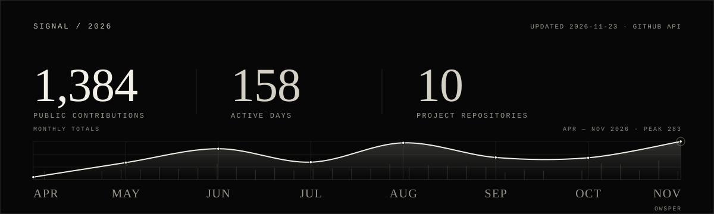

  

  Local-first tools, simulation and machine perception.

  <a href="#01-selected-systems">WORK</a> &nbsp;·&nbsp; <a href="#02-index">INDEX</a> &nbsp;·&nbsp; <a href="#03-bench">BENCH</a> &nbsp;·&nbsp; <a href="#04-signal">SIGNAL</a> &nbsp;·&nbsp; <a href="https://github.com/Owsper">GITHUB</a>

---

> **Direction.** Most of what is public here is software: local-first tools, simulation, machine perception. The layer I keep moving toward is underneath it — firmware, sensors, and code that has to answer to a physical system. That work is not public yet.

## 01 Selected systems

Three projects, chosen for what they show about how I build: a product with operational weight, a tool with an evidence trail, and a simulation where the physics has to hold.

### 01 · [Vera](https://github.com/Owsper/vera-church-management-system-showcase)

**Operations software for a parish, built end to end.**

A desktop client and a server for the daily work of a church: members and families, donations, accounting, budgets, events and reports. Designed, built and tested as one system; the source is private, and the public repository records the architecture, data model and product decisions.

`Python` · `PySide6` · `FastAPI` · `PostgreSQL` · `JWT`

Completed private product · [Case study](https://github.com/Owsper/vera-church-management-system-showcase)

### 02 · [CONSUL](https://github.com/Owsper/Consul-Formerly-HireMeQuackers)

**A job search that treats every claim as a claim.**

A local-first workspace for job discovery, matching and application tracking. Thirteen source connectors feed a scored shortlist; generated documents may only use facts from an approved Ground Truth ledger the generator cannot bypass.

`Python` · `Streamlit` · `SQLAlchemy` · `SQLite` · `Gemini / OpenAI-compatible`

Active · Local-only data · 13 connectors · 117 mocked tests · [Repository](https://github.com/Owsper/Consul-Formerly-HireMeQuackers)

### 03 · [WW2-Dogfight](https://github.com/Owsper/WW2-Dogfight)

**Flight, modelled as force.**

An in-progress Unity 6 HDRP prototype: a Bf 109 over sculpted terrain, rebuilt Input System controls and rigidbody thrust. Small and early — built to test how force, camera and terrain behave together.

`Unity 6000.5.9f1` · `HDRP 17.5` · `C# / HLSL`

Early prototype · [Repository](https://github.com/Owsper/WW2-Dogfight)

## 02 Index

Ten project repositories, plus this profile. Grouped by what they are; the featured three are above.

**Product systems**

- **[Vera](https://github.com/Owsper/vera-church-management-system-showcase)** — Parish operations; private client/server, public case study. `Python` · `PySide6` · `FastAPI` · `PostgreSQL`
- **[CONSUL](https://github.com/Owsper/Consul-Formerly-HireMeQuackers)** — Local-first job discovery, evidence-backed tailoring and application tracking. `Python` · `Streamlit` · `SQLite`
- **[IDMS](https://github.com/Owsper/IDMS)** — Members, documents, meetings, finance and voting; 202 commits and a broad test suite. `Flask` · `SQLite`
- **[Alpine](https://github.com/Owsper/Alpine)** — Interview rehearsal with sourced company facts and quote-backed scoring. `React 19` · `Hono` · `FastAPI` · `Whisper`

**Perception**

- **[Assistive Object Classifier](https://github.com/Owsper/Assistive-Object-Classifier)** — Fifteen household classes; custom CNN, EfficientNetV2 and ConvNeXt compared, with Grad-CAM and SHAP. `PyTorch` · `Gradio` · [live demo](https://huggingface.co/spaces/owsper/assistive-object-classifier)
- **[rimes-ocr-benchmark](https://github.com/Owsper/rimes-ocr-benchmark)** — Four OCR engines on 100 French handwriting lines; PaddleOCR leads at 15.43% CER. `PaddleOCR` · `Tesseract` · `TrOCR` · `EasyOCR`
- **[MINT](https://github.com/Owsper/MINT)** — Early scaffold for paper evaluation and handwriting detection; the entry point is still a placeholder. `Python` · early

**Interactive**

- **[WW2-Dogfight](https://github.com/Owsper/WW2-Dogfight)** — Unity 6 HDRP dogfight scene; terrain, Input System and rigidbody-driven flight. `C# / HLSL` · `Unity`
- **[Minom](https://github.com/Owsper/Minom)** — Fabric mod for Minecraft 1.19.2; the first shipped block is `minom:wet_sand`. `Java` · `Fabric`
- **[Barthelomew](https://github.com/Owsper/Barthelomew)** — Manifest V3 browser extension that spawns a teddy bear on the current page. `JavaScript` · `MIT`

## 03 Bench

Tools that appear in the repositories above. An inventory, not a proficiency scale.

**Languages** — `Python` `TypeScript` `JavaScript` `Java` `C# / HLSL` `HTML / CSS`

**Backend & data** — `FastAPI` `Flask` `Hono` `SQLAlchemy` `Pydantic` `SQLite` `PostgreSQL` `Supabase`

**Interfaces** — `React 19` `Vite 8` `Streamlit` `PySide6` `Gradio`

**Perception & ML** — `PyTorch` `Hugging Face Transformers` `ConvNeXt` `EfficientNetV2` `Grad-CAM` `SHAP` `faster-whisper` `Kokoro ONNX` `PaddleOCR` `Tesseract` `TrOCR` `EasyOCR` `Gemini` `OpenAI-compatible APIs`

**Simulation & tooling** — `Unity 6 HDRP` `Fabric (Minecraft 1.19.2)` `Chrome Manifest V3` `pytest` `Vitest` `GitHub Actions`

## 04 Signal

  

Regenerated weekly and on demand by [the activity workflow](.github/workflows/refresh-activity.yml). It reads the GitHub API directly; there are no third-party statistics cards, and the last committed asset remains in place if the API is unavailable.

## 05 Contact

**GitHub** — [github.com/Owsper](https://github.com/Owsper)

The account lists no public email, website or social profile. GitHub is the only channel.

---

Every repository and technology listed here is verifiable in the public repositories. Last reviewed November 2026.
