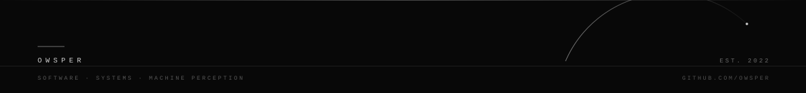

  

  Local-first tools, applied machine learning, and interfaces that show their work.

  <a href="#selected-work">WORK</a> &nbsp;·&nbsp; <a href="#repository-index">INDEX</a> &nbsp;·&nbsp; <a href="#technology">STACK</a> &nbsp;·&nbsp; <a href="#activity">ACTIVITY</a> &nbsp;·&nbsp; <a href="https://github.com/Owsper">GITHUB</a>

---

## ABOUT

I build complete systems rather than isolated demos: a local-first job-search and CV workspace, an AI interview rehearsal app, an explainable object classifier, and a client/server management product.

The work across this account moves between Python and TypeScript services, Flask and FastAPI backends, React and Streamlit interfaces, PyTorch computer vision, and — further out — Unity and Minecraft modding. Everything below is drawn from the public repositories. Nothing is a skill rating.

## SELECTED WORK

Four repositories carry the deepest engineering. The other six stay reachable in the [index](#repository-index).

### 01 · [Alpine](https://github.com/Owsper/Alpine)

**Rehearse the interview. Then just show up.**

Paste a job post, review company facts with linked sources, take a spoken interview, and get six scores that quote your own answers — then a next session aimed at your weakest dimensions.

`React 19` · `Vite 8` · `TypeScript / Hono` · `FastAPI` · `Whisper` · `Kokoro ONNX` · `Supabase`

MVP · [Repository](https://github.com/Owsper/Alpine) · [Promo, 0:41](https://cdn.jsdelivr.net/gh/Owsper/Alpine@main/video/out/alpine-promo.mp4) · [Product demo, 1:26](https://cdn.jsdelivr.net/gh/Owsper/Alpine@main/video/out/alpine-demo.mp4)

### 02 · [CONSUL](https://github.com/Owsper/Consul-Formerly-HireMeQuackers)

**A job search where every claim is traceable to evidence.**

A local-first Streamlit workspace for job discovery, matching and application tracking. Thirteen source connectors feed a scored shortlist; generated CVs may only use facts from an approved Ground Truth ledger.

`Python` · `Streamlit` · `SQLAlchemy` · `SQLite` · `Gemini / OpenAI-compatible`

Local-only data · 13 connectors · 117 mocked tests · [Repository](https://github.com/Owsper/Consul-Formerly-HireMeQuackers)

### 03 · [Vera](https://github.com/Owsper/vera-church-management-system-showcase)

**A church, run from one system.**

A private client–server product for members and families, donations, accounting, budgets, events and reports. Designed, built and tested end to end; the repository is the public showcase of the decisions and interface.

`Python` · `PySide6` · `FastAPI` · `PostgreSQL` · `JWT`

Source private · [Showcase repository](https://github.com/Owsper/vera-church-management-system-showcase)

### 04 · [Assistive Object Classifier](https://github.com/Owsper/Assistive-Object-Classifier)

**Fifteen everyday objects, and a model that explains itself.**

An image classifier for assistive contexts, comparing a custom CNN, EfficientNetV2-S and ConvNeXt-Tiny across 15 household classes, with Grad-CAM and SHAP visualisations and a Gradio interface.

`PyTorch` · `ConvNeXt-Tiny` · `Grad-CAM` · `SHAP` · `Gradio`

Research prototype · [Repository](https://github.com/Owsper/Assistive-Object-Classifier) · [Live demo](https://huggingface.co/spaces/owsper/assistive-object-classifier)

Also carrying weight: **[IDMS](https://github.com/Owsper/IDMS)**, a 202-commit Flask/SQLite platform for members, documents, meetings, finance and voting, and **[WW2-Dogfight](https://github.com/Owsper/WW2-Dogfight)**, a Unity 6 HDRP dogfight scene.

## REPOSITORY INDEX

All ten public repositories, grouped by what they are.

#### Applied AI & perception

**[Alpine](https://github.com/Owsper/Alpine)** — AI interview rehearsal with sourced company facts, spoken sessions and quote-backed scoring.
`TypeScript` · `React` · `FastAPI` · MVP

**[Assistive-Object-Classifier](https://github.com/Owsper/Assistive-Object-Classifier)** — Explainable 15-class object classifier with a deployed Gradio demo.
`Python` · `PyTorch` · `Gradio`

**[rimes-ocr-benchmark](https://github.com/Owsper/rimes-ocr-benchmark)** — CPU-only benchmark of four OCR engines on 100 French handwriting lines; PaddleOCR leads at 15.43% CER.
`Python` · `PaddleOCR` · `Tesseract` · `TrOCR` · `EasyOCR`

**[MINT](https://github.com/Owsper/MINT)** — Early scaffold for paper evaluation and handwriting detection; the repository currently holds the description and a placeholder entry point.
`Python` · early

#### Product & platform systems

**[Consul-Formerly-HireMeQuackers](https://github.com/Owsper/Consul-Formerly-HireMeQuackers)** — Local-first job discovery, evidence-backed CV tailoring and application tracking.
`Python` · `Streamlit` · `SQLite`

**[vera-church-management-system-showcase](https://github.com/Owsper/vera-church-management-system-showcase)** — Public showcase of a private PySide6 / FastAPI / PostgreSQL management product.
`Docs` · `Screenshots` · private source

**[IDMS](https://github.com/Owsper/IDMS)** — Flask and SQLite platform for members, documents, teams, meetings, finance and voting, with server-rendered HTML pages and a broad test suite.
`Python` · `Flask` · `SQLite` · `HTML`

#### Interactive & simulation

**[WW2-Dogfight](https://github.com/Owsper/WW2-Dogfight)** — Unity 6 HDRP dogfight scene with terrain, input system and rigidbody-driven flight.
`C# / HLSL` · `Unity` · `HDRP`

**[Minom](https://github.com/Owsper/Minom)** — Fabric mod for Minecraft 1.19.2 on Java 17; the first shipped block is `minom:wet_sand`.
`Java` · `Fabric`

**[Barthelomew](https://github.com/Owsper/Barthelomew)** — Manifest V3 browser extension that spawns a teddy bear on the current page.
`JavaScript` · `CSS` · `MIT`

## TECHNOLOGY

Only tools and languages that appear in the repositories above.

**Languages** — `Python` `TypeScript` `JavaScript` `Java` `C# / HLSL` `HTML / CSS`

**Backend & data** — `FastAPI` `Flask` `Hono` `SQLAlchemy` `Pydantic` `SQLite` `PostgreSQL` `Supabase`

**Interfaces** — `React 19` `Vite 8` `Streamlit` `PySide6` `Gradio`

**Machine learning** — `PyTorch` `Hugging Face Transformers` `ConvNeXt` `EfficientNetV2` `Grad-CAM` `SHAP` `faster-whisper` `Kokoro ONNX` `PaddleOCR` `Tesseract` `TrOCR` `EasyOCR` `Gemini` `OpenAI-compatible APIs`

**Simulation & tooling** — `Unity 6 HDRP` `Fabric (Minecraft 1.19.2)` `Chrome Manifest V3` `pytest` `Vitest` `GitHub Actions`

## ACTIVITY

  

Regenerated weekly and on demand by [the activity workflow](.github/workflows/refresh-activity.yml). It reads the GitHub API directly; there are no third-party statistics cards, and the last committed asset remains in place if the API is unavailable.

## CONTACT

**GitHub** — [github.com/Owsper](https://github.com/Owsper)

**Live project** — [Assistive Object Classifier on Hugging Face](https://huggingface.co/spaces/owsper/assistive-object-classifier)

No public email, website or social profile is listed on this GitHub account. This profile is the canonical point of contact.

---

  

Every repository and technology listed here is verifiable in the public repositories. Last reviewed November 2026.
